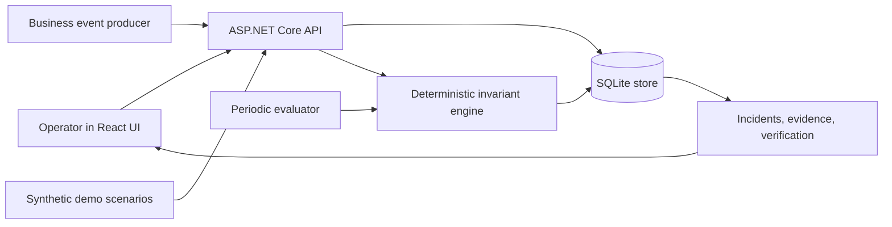

# Architecture and decisions

## Runtime shape

The browser and API are served from the same origin in the packaged app. During frontend development, Vite proxies API requests. The API owns validation, persistence, evaluation, and recovery decisions. The UI displays server state and sends commands; it is not a second evaluator.

The service serializes mutations under one process-local lock. It copies the current workspace, applies a command and evaluation, and commits an atomic serialized snapshot in SQLite before replacing the in-memory state. A rejected batch leaves the stored workspace unchanged. The workspace supports up to 25,000 events, 200 rules, and 30,000 obligations. The evaluator groups events by journey and trigger type in memory.

## Core records

| Record | Purpose |
| --- | --- |
| Application | Correlation boundary and recognizable source-system name |
| Rule | Immutable trigger/outcome/deadline definition; enabled flag controls new obligations |
| Event | Stable application-scoped ID, journey correlation, event time, receipt time, and data |
| Evaluation | One obligation per rule and trigger event, with deadline, matching evidence, and status |
| Incident | Persistent history for an observed violation, including acknowledgment and verification |

The [API contract](api-contract.md) describes the JSON shapes and supported commands.

## Time and matching

The server evaluates at a supplied internal clock instant. Callers cannot move the evaluation clock through an API request. An outcome must share the trigger's application and correlation ID, have a required event type, occur at or after the trigger, and not occur after the evaluation instant.

An obligation is pending before its deadline if evidence is incomplete. All required types occurring on or before the deadline produce on-time satisfaction. A missing type after the deadline produces a violation. Late outcome evidence can restore the business outcome but does not erase the original missed deadline. Delayed delivery of an event that occurred on time can change the current evaluation; the incident already observed is retained until explicit verification.

An event's receipt time is distinct from its producer-reported event time. This distinction supports investigation, but producer timestamps are still trusted inputs within validation bounds. The MVP is not a signed audit system.

## ADR 001: deterministic rules instead of runtime language-model decisions

**Decision:** Support a small structured rule vocabulary and evaluate it in ordinary code. Generate diagnosis from stored evidence; label possible causes as hypotheses.

**Reason:** Deadline decisions must be repeatable, testable, explainable, and available without an external model or secret. Unstructured generation is not required to identify a missing configured event. This also keeps the demo runnable offline after dependencies are installed.

**Tradeoff:** Rules are less expressive than a general business language. A future assistant could draft a rule or summarize evidence, but a human would approve the structured rule and deterministic code would still decide violations. No such assistant is claimed in this release.

## ADR 002: ASP.NET Core, React, and SQLite

**Decision:** Use a single ASP.NET Core service with a practical React frontend and SQLite persistence.

**Reason:** This is a solo-project MVP. One service and a file-backed database make local setup, container packaging, and reproducible demos easier than introducing a broker and several services before they are needed.

**Tradeoff:** The design targets one process and a modest event volume. It does not offer distributed workers, horizontal write scaling, a high-volume stream processor, or a managed database. Move to a transactional server database and queue when measurements justify that work.

## ADR 003: immutable rule definitions

**Decision:** Rule semantics are immutable after creation. A rule may be paused; a changed expectation is a new rule.

**Reason:** An incident must retain a stable meaning. Editing a deadline or expected event after a failure should not silently rewrite what the business had promised.

**Tradeoff:** The MVP has no full rule-version migration UI. Preview replacement rules and pause the old rule deliberately. Existing obligations continue to be evaluated. A paused rule creates no unseen obligations while it is paused. Resuming deliberately backfills retained triggers, just as a new rule evaluates historical events; pause is not a permanent exclusion window.

## ADR 004: recovery evidence, not external remediation

**Decision:** Verification checks persisted events and records the evidence used. It never calls a fulfilment, identity, payment, or HR system to perform a correction. A separate demo-only action creates synthetic recovery evidence.

**Reason:** A general-purpose monitoring MVP cannot safely infer or authorize arbitrary business actions. The operator remains responsible for correcting the source system and reviewing the evidence.

**Tradeoff:** Verification confirms the configured evidence contract, not physical-world completion or trusted source truth. Real integrations need independent authentication, scoped permissions, action approvals, and postcondition checks.

## ADR 005: at-least-once ingestion and correlation

**Decision:** Require stable producer event IDs. Identical retries are safe; changed content under the same application-scoped event ID is a conflict. Batches are atomic. Correlation is scoped to an application and a journey ID.

**Reason:** Producers commonly retry deliveries. Duplicate delivery should not produce duplicate obligations or incidents, and unrelated applications must not satisfy one another's commitments.

**Tradeoff:** Producers are responsible for consistent IDs and one journey per correlation ID. There is no exactly-once distributed delivery claim, schema registry, or global business-entity deduplication.

## Operational limits

Use a persistent volume for SQLite when running a container. Run only one API process against a database file: the process-local lock does not coordinate multiple writers. Back up and restore using SQLite-aware procedures while the application is stopped or using a consistent database backup. There is no built-in retention policy, encryption at rest, disaster recovery automation, or high-availability deployment. Snapshot persistence and repeated scans favor modest workloads; the configured storage caps are safeguards, not throughput guarantees. The app reports observed evidence and should not be the sole control for financially or security-critical workflows.
